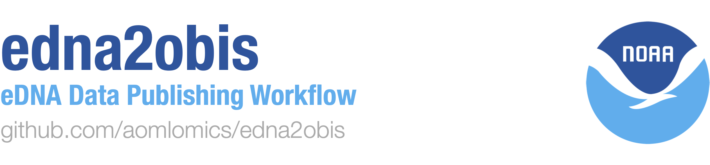
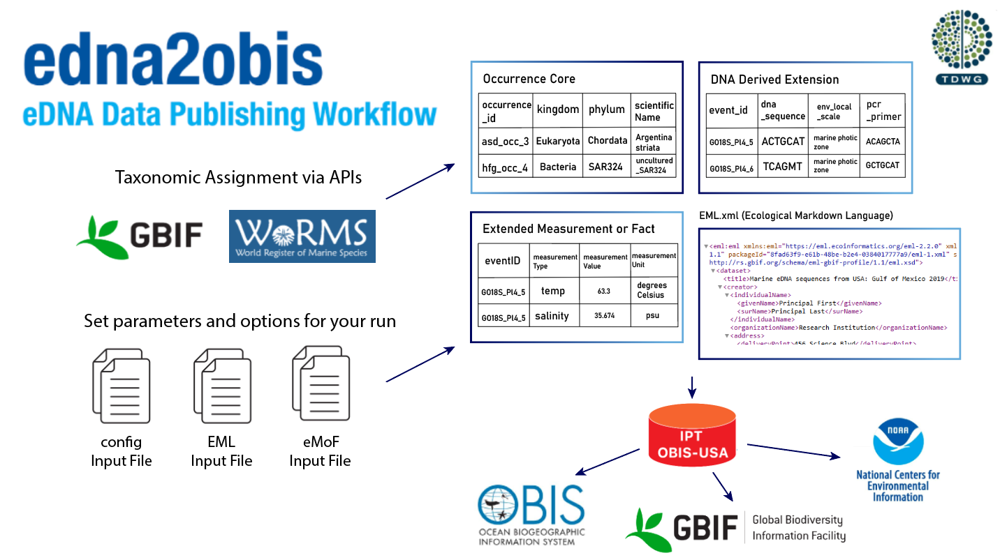
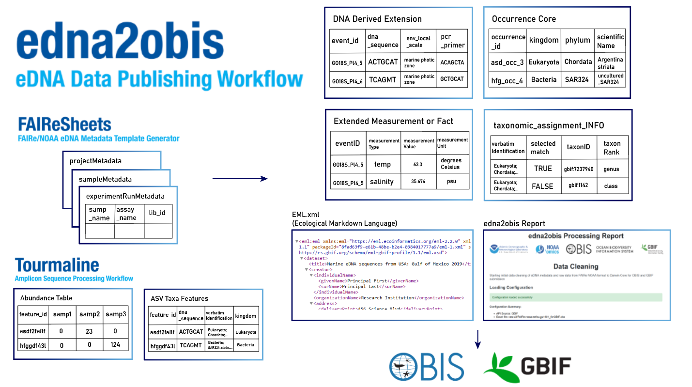

edna2obis converts eDNA metabarcoding data in [FAIRe](https://fair-edna.github.io/index.html) format into [Darwin Core](https://dwc.tdwg.org/) Archives ready to publish on [OBIS](https://obis.org/) and [GBIF](https://www.gbif.org/). It produces an Occurrence Core with the [DNA derived data extension](https://tools.gbif.org/dwca-validator/extension.do?id=http://rs.gbif.org/terms/1.0/DNADerivedData), maps your taxonomy to [WoRMS](https://www.marinespecies.org/) or the GBIF backbone, and can also write an eMoF, `eml.xml` and `meta.xml`. It follows GBIF's guide to [publishing DNA-derived data through biodiversity data platforms](https://docs.gbif.org/publishing-dna-derived-data/en/).

[](https://www.youtube.com/watch?v=bhNuE15icpQ&list=PLS6jqgZoUzto&index=11)

## Contents

- [Features](#features)
- [Quick start](#quick-start)
- [Preparing your data](#preparing-your-data)
- [Configuration](#configuration)
- [Outputs](#outputs)
- [Taxonomic mapping](#taxonomic-mapping)
- [Troubleshooting](#troubleshooting)
- [Versions and releases](#versions-and-releases)
- [Example data and published datasets](#example-data-and-published-datasets)
- [Disclaimer](#disclaimer)

## Features

- One command (`python main.py`), configured entirely through YAML files
- Supports both **generic FAIRe** and **FAIRe NOAA** metadata (compatible with [Ocean DNA Explorer](https://www.oceandnaexplorer.org/))
- Taxonomic mapping to WoRMS or GBIF, with caching, parallel requests, optional species-level skipping per assay, and a transparent `taxa_mapping_INFO_<API>.xlsx` listing every candidate match
- Optional `eMoF.csv`, project-level `eml.xml` and `meta.xml`
- HTML run report with settings, warnings and output previews
- `taxamapper.py` for taxonomic mapping on its own



## Quick start

**Prerequisites:** Python 3.13, Git, an internet connection (for the WoRMS/GBIF APIs) and at least 8 GB RAM.

**1. Clone the repository**

```bash
git clone https://github.com/aomlomics/edna2obis.git
cd edna2obis
```

**2. Create a Python environment**, with either conda:

```bash
conda env create -f environment.yml
conda activate edna2obis
```

or `venv` + `pip`:

```bash
python -m venv .venv
source .venv/bin/activate        # Windows (PowerShell): .venv\Scripts\Activate.ps1
pip install -r requirements.txt
```

**3. Run the bundled example**

```bash
python main.py
```

The default `config.yaml` runs the small FAIRe NOAA example in [`data/example_raw/FAIRe_NOAA_example_dataset_small/`](data/example_raw/FAIRe_NOAA_example_dataset_small/) and writes results to `outputs/EXAMPLE_OUTPUT_FAIRE_NOAA_SMALL/`. The HTML report opens in your browser when the run finishes.

**4. Run your own data:** prepare your files ([Preparing your data](#preparing-your-data)), point `config.yaml` at them ([Configuration](#configuration)) and run `python main.py` again.

## Preparing your data



You need:

- **FAIRe metadata**: `projectMetadata`, `sampleMetadata` and `experimentRunMetadata`, plus one `analysisMetadata` per analysis run for FAIRe NOAA. Generate the templates with [FAIReSheets](https://github.com/aomlomics/FAIReSheets). They can be separate TSV files or sheets in a single Excel file.
- **Two raw data files per analysis run**: an ASV taxonomy table and an ASV abundance table, in [Tourmaline](https://github.com/aomlomics/tourmaline) output format. QIIME 2 `.qza` outputs can be converted with [`src/create_asv_seq_taxa_obis.sh`](src/create_asv_seq_taxa_obis.sh).

The main difference between the two formats is where the analysis metadata lives:

| | Generic FAIRe | FAIRe NOAA |
|---|---|---|
| `metadata_format` | `"GENERIC"` | `"NOAA"` |
| Analysis metadata | Per-assay columns in `projectMetadata` | One `analysisMetadata` per analysis run |
| Sequence ID column in raw tables | `seq_id` | `featureid` |

See **[docs/input-data.md](docs/input-data.md)** for every table, with filled-in examples.

## Configuration

All configuration files are in the repository root.

| File | What it controls |
|---|---|
| [`config.yaml`](config.yaml) | The run: input paths, metadata format, taxonomy API and matching options, output folder, optional outputs. Read by `main.py`. |
| [`EXAMPLE_config_FAIRe_noaa.yaml`](EXAMPLE_config_FAIRe_noaa.yaml), [`EXAMPLE_config_FAIRe_generic.yaml`](EXAMPLE_config_FAIRe_generic.yaml) | Starting points for each format. Copy one over `config.yaml`, or set `run_config_path` in `config.yaml` to point at your own file. |
| [`data_mapper.yaml`](data_mapper.yaml) | Which FAIRe fields map to which Darwin Core terms in each output |
| [`EML_config.yaml`](EML_config.yaml), [`contacts.yaml`](contacts.yaml) | Dataset metadata and people for `eml.xml` |
| [`data/example_raw/eMoF_Fields_edna2obis.tsv`](data/example_raw/eMoF_Fields_edna2obis.tsv) | Measurements written to the eMoF ([details](docs/outputs.md#emof-extended-measurement-or-fact)) |

Key settings in `config.yaml`. Each one is documented in comments in the file.

| Setting | Meaning |
|---|---|
| `edna2obis_run_name` | Names the output subfolder, report and saved config |
| `metadata_format` | `"NOAA"` or `"GENERIC"` |
| `combined_metadata_file` | `true`: all metadata sheets in one Excel file (`excel_file`). `false`: separate TSV files (`sampleMetadata_file`, `experimentRunMetadata_file`, `projectMetadata_file`) |
| `datafiles` | One entry per analysis run with its `assay_name`, `taxonomy_file`, `occurrence_file` (and `analysisMetadata_file` for NOAA TSVs) |
| `taxonomic_api_source` | `"WoRMS"` or `"GBIF"` |
| `assays_to_skip_species_match` | Assays (e.g. 16S) whose species-level names should be ignored |
| `output_dir` | Parent folder for results (default `outputs/`) |
| `emof_enabled`, `eml_enabled` | Turn the optional outputs on or off |
| `split_output_by_short_name` | Write one set of files per cruise/expedition |

## Outputs

Each run writes to `outputs/<edna2obis_run_name>/`:

- `occurrence_core_<api>.csv`: Occurrence Core
- `dna_derived_extension.csv`: DNA Derived Data extension
- `taxa_mapping_INFO_<API>.xlsx`: all candidate taxonomy matches. **Filter on `selected_match = TRUE`** for the match that was used.
- `eMoF.csv`, `eml.xml`, `meta.xml`: optional Darwin Core Archive files
- `edna2obis_report_<API>_<edna2obis_run_name>.html`: run report
- `config_<edna2obis_run_name>.yaml`: copy of the config used

See **[docs/outputs.md](docs/outputs.md)** for example rows and eMoF details.

## Taxonomic mapping

Taxonomic *assignment* (matching ASVs to names) happens before edna2obis, in your bioinformatics workflow. edna2obis *maps* those names (`verbatimIdentification`) to WoRMS or the GBIF backbone so the records can be published. It starts at the most specific rank, walks up until it finds an accepted match, and records every candidate in `taxa_mapping_INFO_<API>.xlsx`.

- **[docs/taxonomic-mapping.md](docs/taxonomic-mapping.md)**: how WoRMS and GBIF matches are chosen, the settings that affect them, and what every `taxa_mapping_INFO` column means
- **[docs/taxamapper.md](docs/taxamapper.md)**: run taxonomic mapping on its own for a list of names, e.g. `python taxamapper.py -i names.tsv -a WoRMS`

## Troubleshooting

- **Environment creation fails:** run `conda update conda`, then `conda env create -f environment.yml` again.
- **API timeouts:** reduce `worms_n_proc` or `gbif_n_proc` in `config.yaml`.
- **Missing data files:** check every path in `config.yaml`; relative paths are resolved from the folder you run `python main.py` in (normally the repository root), or use absolute paths.
- **Unexpected or missing fields:** check that your data follows the FAIRe NOAA or generic FAIRe format and that `metadata_format` matches it.
- The HTML report and the terminal output list detailed warnings and errors for each step.

For large datasets, 4+ CPU cores, 8 GB+ RAM and about 1 GB of free disk space are recommended.

## Versions and releases

The latest version is on the [Releases](https://github.com/aomlomics/edna2obis/releases) page, and [CHANGELOG.md](CHANGELOG.md) lists what changed in each version. Check your version with `python main.py --version`. Releases follow [Semantic Versioning](https://semver.org/); see [docs/RELEASING.md](docs/RELEASING.md) for the process.

## Example data and published datasets

Example inputs are in [`data/example_raw/`](data/example_raw/): a small and a large FAIRe NOAA dataset, and a generic FAIRe dataset from GOMECC-4.

The GOMECC-4 dataset is published on [GBIF](https://www.gbif.org/dataset/9012def0-bd87-48a0-ac9e-e0e78dd37689) and [OBIS](https://obis.org/dataset/210efc7c-4762-47ee-b4b5-22a0f436ef44).

<details>
<summary>GOMECC-4 abstract</summary>

Seawater was collected on board the NOAA ship Ronald H. Brown as part of the fourth Gulf of Mexico Ecosystems and Carbon Cycle (GOMECC-4) cruise from September 13 to October 21, 2021. Sampling for GOMECC-4 occurred along 16 coastal-offshore transects across the entire Gulf of Mexico and an additional line at 27N latitude in the Atlantic Ocean. We also collected eDNA samples near Padre Island National Seashore (U.S. National Parks Service), a barrier island located off the coast of south Texas. Vertical CTD sampling was employed at each site to measure discrete chemical, physical, and biological properties. Water sampling for DNA filtration was conducted at 54 sites and three depths per site (surface, deep chlorophyll maximum, and near bottom) to capture horizontal and vertical gradients of bacterial, protistan, and metazoan diversity across the Gulf. The resulting ASVs, their assigned taxonomy, and the metadata associated with their collection are the input data for the OBIS conversion scripts presented here.

</details>

## Disclaimer

This repository is a scientific product and is not official communication of the National Oceanic and Atmospheric Administration, or the United States Department of Commerce. All NOAA GitHub project code is provided on an 'as is' basis and the user assumes responsibility for its use. Any claims against the Department of Commerce or Department of Commerce bureaus stemming from the use of this GitHub project will be governed by all applicable Federal law. Any reference to specific commercial products, processes, or services by service mark, trademark, manufacturer, or otherwise, does not constitute or imply their endorsement, recommendation or favoring by the Department of Commerce. The Department of Commerce seal and logo, or the seal and logo of a DOC bureau, shall not be used in any manner to imply endorsement of any commercial product or activity by DOC or the United States Government.
