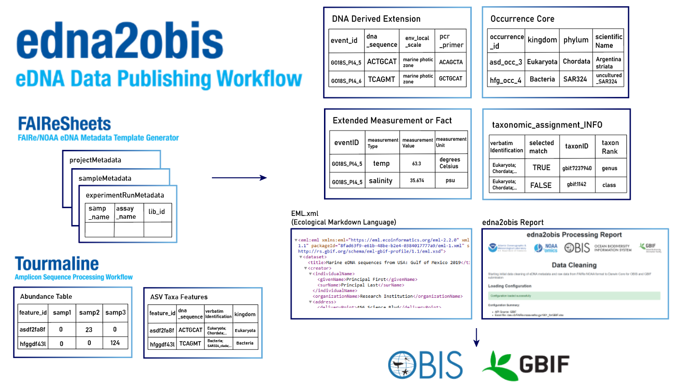

# Input data

edna2obis needs two kinds of input: FAIRe metadata describing the project, samples, sequencing and analyses, and the raw ASV taxonomy and abundance tables for each analysis.

- Metadata tables come from running [FAIReSheets](https://github.com/aomlomics/FAIReSheets) (projectMetadata, sampleMetadata, experimentRunMetadata; and the NOAA data format variation requires an analysisMetadata sheet per analysis run).
- Raw ASV taxonomy and abundance tables come from Tourmaline (or any amplicon sequence processing workflow) as long as they follow Tourmaline's output structure.



## Generic FAIRe vs FAIRe NOAA

Both formats can be generated by [FAIReSheets](https://github.com/aomlomics/FAIReSheets). Set `metadata_format` in `config.yaml` to match your data.

| | Generic FAIRe | FAIRe NOAA |
|---|---|---|
| `metadata_format` | `"GENERIC"` | `"NOAA"` |
| Analysis (bioinformatics) metadata | Per-assay columns in `projectMetadata` | One `analysisMetadata` sheet/file per analysis run |
| Sequence ID column in raw tables | `seq_id` | `featureid` |
| Ocean DNA Explorer compatible | | ✓ |
| Example config | [`EXAMPLE_config_FAIRe_generic.yaml`](../EXAMPLE_config_FAIRe_generic.yaml) | [`EXAMPLE_config_FAIRe_noaa.yaml`](../EXAMPLE_config_FAIRe_noaa.yaml) |
| Example data | [`data/example_raw/FAIRe_generic_example_dataset/`](../data/example_raw/FAIRe_generic_example_dataset/) | [`data/example_raw/FAIRe_NOAA_example_dataset_small/`](../data/example_raw/FAIRe_NOAA_example_dataset_small/) |

`sampleMetadata` and `experimentRunMetadata` are the same in both formats. The examples below use the NOAA layout.

## Metadata: NOAA Omics FAIR eDNA-based metadata template

This FAIRe NOAA Google Sheet template was developed by NOAA Omics at AOML and is based on the [FAIRe eDNA data standard](https://fair-edna.github.io/index.html). Run [FAIReSheets](https://github.com/aomlomics/FAIReSheets) to generate these templates in Google Sheets. Here is a filled-in example:

[FAIRe_NOAA_noaa-aoml-gomecc4_SHARING](https://docs.google.com/spreadsheets/d/1mkjfUQW3gTn3ezhMQmFDQn4EBoQ2Xv4SZeSd9sqagoU/edit?gid=0#gid=0)

## projectMetadata

Project wide (project_level) project metadata, and metadata unique to each assay

**Note**: In generic FAIRe format, analysis metadata is included in this sheet rather than in separate analysisMetadata files.

| **term_name**         | project_level                                                                                                            | ssu16sv4v5-emp (1st assay) | ssu18sv9-emp (2nd assay) |
| --------------------- | ------------------------------------------------------------------------------------------------------------------------ | -------------------------- | ------------------------ |
| **recordedBy**        | Luke Thompson                                                                                                            |                            |                          |
| **recordedByID**      | [https://orcid.org/0000-0002-3911-1280](https://orcid.org/0000-0002-3911-1280)                                           |                            |                          |
| **project_contact**   | Luke Thompson                                                                                                            |                            |                          |
| **institution**       | NOAA/AOML                                                                                                                |                            |                          |
| **institutionID**     | [https://www.aoml.noaa.gov/omics](https://www.aoml.noaa.gov/omics)                                                       |                            |                          |
| **project_name**      | eDNA from Gulf of Mexico Ecosystems and Carbon Cruise 2021 (GOMECC-4)                                                    |                            |                          |
| **project_id**        | noaa-aoml-gomecc4                                                                                                        |                            |                          |
| **parent_project_id** | noaa-aoml-gomecc                                                                                                         |                            |                          |
| **study_factor**      | water column spatial series                                                                                              |                            |                          |
| **assay_type**        | metabarcoding                                                                                                            |                            |                          |
| **sterilise_method**  | After sampling, run ~1 L of 5% bleach through tubing lines, then rep...                                                  |                            |                          |
| **checkls_ver**       | FAIRe_checklist_v1.0.xlsx                                                                                                |                            |                          |
| **mod_date**          | 2024-10-31                                                                                                               |                            |                          |
| **license**           | [http://creativecommons.org/publicdomain/zero/1.0/legalcode](http://creativecommons.org/publicdomain/zero/1.0/legalcode) |                            |                          |
| **rightsHolder**      | US Government                                                                                                            |                            |                          |
| **accessRights**      | no rights reserved                                                                                                       |                            |                          |
| **assay_name**        |                                                                                                                          | ssu16sv4v5-emp             | ssu18sv9-emp             |
| **ampliconSize**      |                                                                                                                          | 411                        | 260                      |
| **code_repo**         | [https://github.com/aomlomics/gomecc](https://github.com/aomlomics/gomecc)                                               |                            |                          |
| **biological_rep**    | 3                                                                                                                        |                            |                          |

## sampleMetadata

Contextual data about the samples collected. Each row is a distinct sample (Event)

| samp_name               | materialSampleID             | geo_loc_name                                | eventDate              | decimalLatitude | decimalLongitude | sampleSizeValue | sampleSizeUnit | env_broad_scale              | env_local_scale                         | env_medium                | samp_collect_device          | samp_vol_we_dna_ext | samp_mat_process                                                | size_frac |
| ----------------------- | ---------------------------- | ------------------------------------------- | ---------------------- | --------------- | ---------------- | --------------- | -------------- | ---------------------------- | --------------------------------------- | ------------------------- | ---------------------------- | ------------------- | --------------------------------------------------------------- | --------- |
| GOMECC4_27N_Sta1_Deep_A | GOMECC4_27N_Sta1_Deep        | USA: Atlantic Ocean, east of Florida (27 N) | 2021-09-14T11:00-04:00 | 26.997          | -79.618          | 1920            | mL             | marine biome [ENVO:00000447] | marine mesopelagic zone [ENVO:00000213] | sea water [ENVO:00002149] | Niskin bottle on CTD rosette | 1920 mL             | Pumped through Sterivex filter (0.22-µm) using peristaltic pump | 0.22 µm   |
| GOMECC4_27N_Sta1_Deep_B | GOMECC4_PANAMACITY_Sta1_Deep | USA: Atlantic Ocean, east of Florida (27 N) | 2021-09-20T23:13-04:00 | 26.997          | -79.618          | 1920            | mL             | marine biome [ENVO:00000447] | marine mesopelagic zone [ENVO:00000213] | sea water [ENVO:00002149] | Niskin bottle on CTD rosette | 1920 mL             | Pumped through Sterivex filter (0.22-µm) using peristaltic pump | 0.22 µm   |

## experimentRunMetadata

Library preparation and sequencing details

| samp_name                 | assay_name     | pcr_plate_id   | lib_id         | seq_run_id              | mid_forward | mid_reverse | filename                                 | filename2                                | input_read_count |
| ------------------------- | -------------- | -------------- | -------------- | ----------------------- | ----------- | ----------- | ---------------------------------------- | ---------------------------------------- | ---------------- |
| GOMECC4_NegativeControl_1 | ssu16sv4v5-emp | not applicable | GOMECC16S_Neg1 | 20220613_Amplicon_PE250 | TAGCAGCT    | CTGTGCCTA   | GOMECC16S_Neg1_S499_L001_R1_001.fastq.gz | GOMECC16S_Neg1_S499_L001_R2_001.fastq.gz | 29319            |
| GOMECC4_NegativeControl_2 | ssu16sv4v5-emp | not applicable | GOMECC16S_Neg2 | 20220613_Amplicon_PE250 | TAGCAGCT    | CTAGGACTA   | GOMECC16S_Neg2_S500_L001_R1_001.fastq.gz | GOMECC16S_Neg2_S500_L001_R2_001.fastq.gz | 30829            |

## analysisMetadata

Bioinformatic analysis configuration metadata. There is one analysisMetadata sheet PER analysis. Append the `analysis_run_name` to the filename, ex: analysisMetadata_gomecc4_16s_p1-2_v2024.10_241122.tsv

**Note**: analysisMetadata sheet(s) is **only present in FAIRe NOAA format**. In generic FAIRe format, this information is included in the projectMetadata sheet.

| **Field**              | Value                                                                      |
| ---------------------- | -------------------------------------------------------------------------- |
| **project_id**         | noaa-aoml-gomecc4                                                          |
| **assay_name**         | ssu16sv4v5-emp                                                             |
| **analysis_run_name**  | gomecc4_16s_p1-2_v2024.10_241122                                           |
| **sop_bioinformatics** | [https://github.com/aomlomics/gomecc](https://github.com/aomlomics/gomecc) |
| **trim_method**        | cutadapt                                                                   |
| **trim_param**         | qiime cutadapt trim-paired                                                 |
| **demux_tool**         | qiime2-2021.2; bcl2fastq v2.20.0                                           |
| **merge_tool**         | qiime2-2021.2; DADA2 1.18                                                  |
| **min_len_cutoff**     | 200                                                                        |
| **otu_db**             | Silva SSU Ref NR 99 v138.1; 515f-926r region; 10.5281/zenodo.8392695       |
| **otu_seq_comp_appr**  | Tourmaline; qiime2-2021.2                                                  |

## Raw Data: ASV Taxonomies and Abundance Tables

You must have two raw data files associated with each analysis (`analysisMetadata`) in your submission. These files are generated by [Tourmaline v2](https://github.com/aomlomics/tourmaline), AOML Omics' amplicon sequence processing workflow.

If your data was generated with Qiime2 or a previous version of Tourmaline, you can convert the `table.qza`, `taxonomy.qza`, and `repseqs.qza` outputs to the correct format using the [`src/create_asv_seq_taxa_obis.sh`](../src/create_asv_seq_taxa_obis.sh) shell script.

Example:  

```bash
# Run this with a qiime2 environment.
bash src/create_asv_seq_taxa_obis.sh -f \
../gomecc_v2_raw/table-16S-merge.qza -t ../gomecc_v2_raw/taxonomy-16S-merge.qza -r ../gomecc_v2_raw/repseqs-16S-merge.qza \
-o ../gomecc_v2_raw/gomecc-16S-asv.tsv
```

Your ASV raw data files should look like this:

### ASV Taxonomy Features

| featureid    | dna_sequence | taxonomy                                 | verbatimIdentification                   | kingdom   | phylum         | other_ranks... | species                | Confidence |
| ------------ | ------------ | ---------------------------------------- | ---------------------------------------- | --------- | -------------- | -------------- | ---------------------- | ---------- |
| 1ce3b5c6d... | TACGA...     | Bacteria;Proteobacteria;Alphaproteoba... | d__Bacteria;p__Proteoba...               | Bacteria  | Proteobacteria | ...            | Clade_Ia               | 0.88       |
| 4e38e8ced... | GCTACTAC...  | Eukaryota;Obazoa;Opisthokonta;Metazoa... | Eukaryota;Obazoa;Opisthokonta;Metazoa... | Eukaryota | Obazoa         | ...            | Clausocalanus furcatus | 0.999      |

**Note**: Taxonomy is complex, so edna2obis accepts any list of taxonomic ranks as long as they are between `verbatimIdentification` and `Confidence`. For example, 16S and 18S assay data can use different rank names and counts. The code assigns taxonomy based on what ranks each API returns.

`verbatimIdentification` strings may or may not include prepended rank prefixes with underscores. The code removes these during processing when present.

`featureid` (`seq_id` in generic FAIRe) is a hash of the DNA sequence and acts as a unique identifier.

Some field values are truncated (`...`) for readability in the documentation. Include complete values in your input files.

### ASV Taxonomy: what edna2obis uses

- This raw taxonomy table is generated by **FAIReSheets** in both generic FAIRe and NOAA-FAIRe formats
- You can fill in the raw taxonomy table Google Sheet, or if you run Tourmaline, you can just use the raw taxonomy table from that output (they are the same format).
- edna2obis sends the value in `verbatimIdentification` to the selected taxonomy API (after cleaning common prefixes and formatting).
- The API response is then used to fill most of the taxonomy fields in your final outputs (e.g., standard ranks and identifiers).

### ASV Abundance Tables

| featureid    | GOMECC4_BROWNSVILLE_Sta63_DCM_A | GOMECC4_BROWNSVILLE_Sta63_DCM_B | GOMECC4_CAMPECHE_Sta91_DCM_A |
| ------------ | ------------------------------- | ------------------------------- | ---------------------------- |
| 1ce3b5c6d... | 0                               | 32                              | 2                            |
| 4e38e8ced... | 15                              | 0                               | 45                           |

Each column name after `featureid` (`seq_id` in generic FAIRe) is a sample name, and must correspond with your sampleMetadata.

If your abundance tables have decimal numbers, that is okay too.

